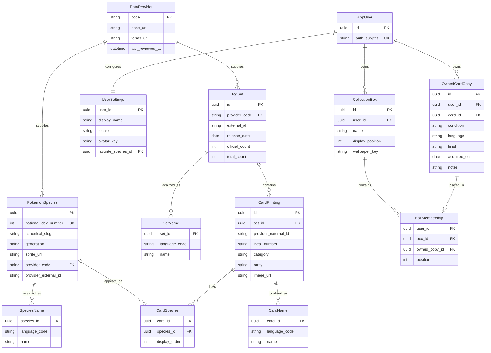

# PokéVault logical data model

This iteration defines identities and integrity rules only; it does not implement a database or migration.

## Entities and constraints

- `DataProvider` stores provenance. Provider plus external ID is unique for `PokemonSpecies`, `TcgSet`, and `CardPrinting`; National Dex number is also unique for species.
- `SpeciesName`, `SetName`, and `CardName` are unique per parent and language. Localized labels never serve as canonical enum identifiers.
- `CardSpecies` preserves display order and is unique by card/species. Pokémon printings may link to multiple species; Trainer and Energy printings have none. Missing provider links remain unresolved rather than guessed.
- `AppUser` is identified by a unique external authentication subject. `UserSettings` is one-to-one and may reference a favorite species.
- `OwnedCardCopy` represents one physical card. `CollectionBox` is a user-owned manual ordering container; species grouping is a query/view concern.
- `BoxMembership` carries `user_id`. Composite foreign keys `(box_id, user_id)` and `(owned_copy_id, user_id)` prevent cross-user membership, and `(box_id, owned_copy_id)` is unique. Deleting a box cascades to memberships only, never to owned copies.

Prices are evidence in this feasibility iteration, not persisted model entities: currency and observation time must be designed before monetary storage. Deferred extensions include price snapshots, transactions and lines, wishlist, decks, scans and candidates, smart-box rules, trade state, and sale state. Physical-copy identity must remain stable when those tables are introduced.

## Runtime TCG catalog boundary (2026-10-22)

The new public catalog adapter does not persist domain rows or change this ERD.
TCGdex `id` maps to the future CardPrinting provider/external-ID identity; language
is metadata/localized content, not a different printing ID. `set.id` and `localId`
remain separate fields. The complete provider `dexId` array maps to the existing
many-to-many CardSpecies concept, including Pikachu & Zekrom (#25/#644). Missing
links remain unresolved; Trainer/Energy normalize to no species associations.

Card DTOs expose recorded variants and optional official fields without owned-copy
quantity, purchase cost or valuation. `available_languages` means resources verified
in the response, not all physical printing languages. The current English discovery
pool also includes Pocket entries; a future inventory slice must explicitly define
physical/digital eligibility rather than treating every public catalog entry as a
physical owned copy. Durable catalog synchronization remains a separate increment.
